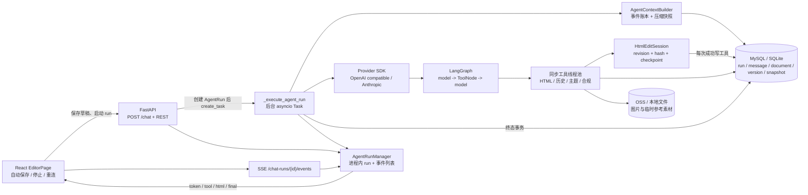
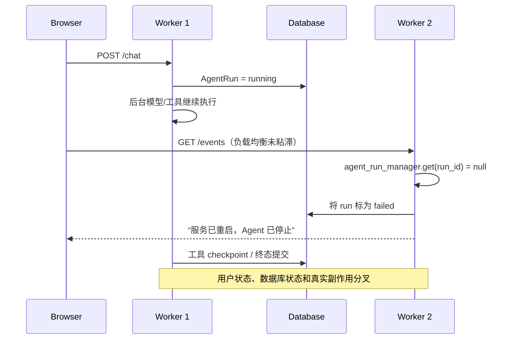
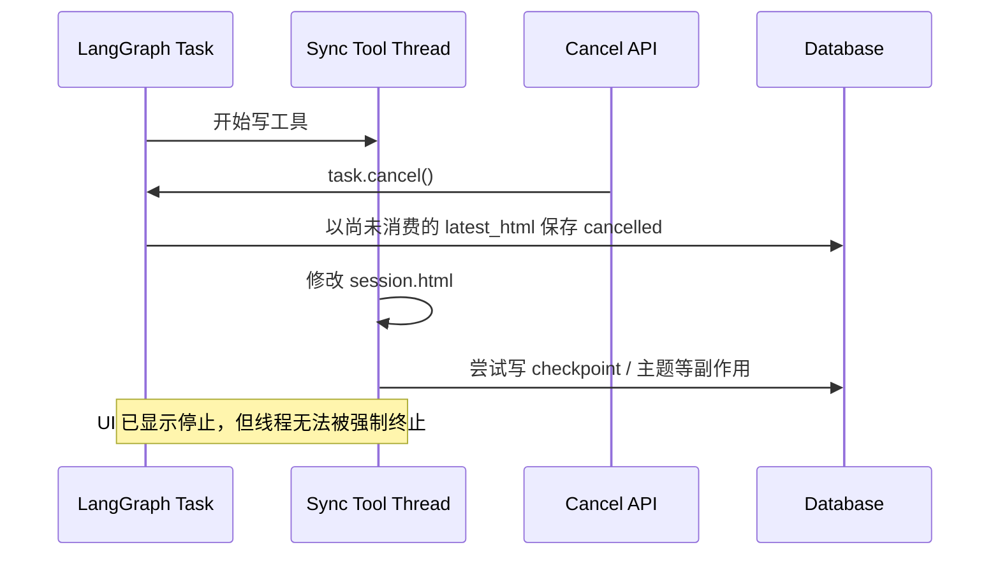

# Agent 全链路健壮性与竞态审计报告

> 审计日期：2026-07-28
>
> 整改更新：2026-07-28 已完成本报告全部 19 项的代码级整改；原始发现保留为整改前证据，
> 第 12 节的状态和验证结果取代此前的“当前风险”结论。
>
> 审计对象：当前工作区（包含未提交修改），不是某个已发布 Git 提交
>
> 审计范围：浏览器交互、FastAPI 接入、Agent 编排、模型流、工具执行、取消与恢复、数据库持久化、对象存储、启动与运维保障

## 1. 结论摘要

当前实现已经具备较好的单进程基础防护：发送前自动保存、文档校验和冲突检测、MySQL 文档行锁、请求幂等 ID、模型流分阶段超时、瞬时错误重试、工具 revision/hash 校验、编辑 checkpoint、终态事务、SSE 序号重放和前端断线重连都已经存在。

但系统现在仍应被视为**单进程、受控并发环境下可用，尚不满足多 worker/多实例生产部署要求**。最严重的问题不是模型本身，而是运行控制面、事件面和临时引用仍是进程内状态，数据库却被多个进程共同解释。多 worker 会把另一个 worker 正在执行的 run 误判为重启遗留任务，并可能同时出现错误终态、继续执行的工具和相互覆盖的恢复结果。

本次共识别：

| 优先级 | 数量 | 含义 |
|---|---:|---|
| P0 | 3 | 上线阻断；生产环境必须消除或以部署约束明确规避 |
| P1 | 13 | 高风险；可能造成数据不一致、资源耗尽、错误用户状态或测试门禁失败 |
| P2 | 3 | 中风险；会降低故障发现、恢复和长期运行能力 |

建议当前生产门禁：

1. 只允许 `uvicorn --workers 1` 且只运行一个应用实例；负载均衡和滚动并发启动均应禁止。
2. 必须显式配置固定 `ENCRYPTION_KEY`、强随机 `SECRET_KEY` 和非默认管理员密码。
3. 修复取消期间同步工具继续执行的竞态，或在修复前将“停止”定义为“请求停止，工具可能仍在收尾”，不能承诺立即无副作用。
4. 增加 JSON/HTML 输入上限、全局并发准入和用户速率限制。
5. 修复后端唯一失败用例，并完成多进程、断网、取消和持久化故障注入测试。
6. 完成 npm 高危通告的适用性确认和依赖处置。

## 2. 架构与关键数据流

### 2.1 正常运行不变量

系统试图维持以下不变量：

- 同一文档同一时间最多一个活跃 Agent。
- 工具只能基于当前 revision 和 block hash 修改 HTML。
- 成功写工具先保存 checkpoint，再向模型和浏览器公布结果。
- Agent 终态在新数据库会话中锁定文档，发现正文已变化则不覆盖外部修改。
- SSE 客户端断开不取消后台任务，重连按序号补拉进程内事件。
- 模型重试只发生在工具尚未执行的模型边界，避免重复写工具。

这些不变量在单进程 MySQL 主路径上大体成立；以下风险集中在跨进程、取消边界、无界资源和旁路写入路径。

## 3. 风险总表

| ID | 优先级 | 结论 | 证据类型 | 主要影响层 |
|---|---|---|---|---|
| R-01 | P0 | 运行、SSE 和临时参考均为进程内状态，多 worker 会误判和交叉收尾 | 静态确认；多实例拓扑触发 | 全链路 |
| R-02 | P0 | 首次多进程启动可能生成不同 Fernet 密钥 | 静态确认；并发启动触发 | 配置持久化 |
| R-03 | P0 | 生产环境允许默认 JWT 密钥和 `admin/admin123` 无条件启动 | 静态确认 | 安全、运维 |
| R-04 | P1 | `_runs` 和完整 SSE 事件永不淘汰，可长期累积完整 HTML | 静态确认 | 执行、内存 |
| R-05 | P1 | 取消 asyncio Task 不能停止已在线程池运行的同步工具 | 静态确认；需故障注入量化 | 工具、终态 |
| R-06 | P1 | 聊天、HTML、补丁 JSON 缺少应用级大小边界 | 静态确认 | 接入、数据库、模型 |
| R-07 | P1 | 没有全局/用户 Agent 并发和速率准入 | 静态确认 | 接入、资源 |
| R-08 | P1 | 版本号 `MAX + 1`，部分文档写路径未统一加锁 | 静态确认 | 文档、版本 |
| R-09 | P1 | SSE 失败后通过 run 状态恢复终态时只刷新消息，不刷新正文 | 静态确认 | 用户交互 |
| R-10 | P1 | 启动 POST 无超时、无 AbortSignal，停止在获得 run_id 前失效 | 静态确认 | 用户交互、接入 |
| R-11 | P1 | 清理循环无异常隔离，且同步 OSS 删除会阻塞事件循环 | 静态确认 | 后台任务、可用性 |
| R-12 | P1 | 上下文快照缺少单 active 唯一约束和会话级串行化 | 静态确认 | 上下文持久化 |
| R-13 | P1 | 对象存储与数据库提交非原子，失败会产生孤儿或缺失对象 | 静态确认 | 图片持久化 |
| R-14 | P1 | 紧预算 Agent 端到端用例稳定失败，压缩契约与文档不一致 | 已复现 | Agent 编排 |
| R-15 | P1 | 启动时直接运行 `create_all` 和手写 DDL，无迁移互斥 | 静态确认；并发启动触发 | 启动、数据库 |
| R-16 | P1 | npm 官方审计报告 3 个高危项，需适用性判定和升级 | 已复现 | 供应链 |
| R-17 | P2 | 图片 Agent 在长模型循环前重新开启事务，可能长期占连接 | 静态确认 | 数据库连接池 |
| R-18 | P2 | 健康检查永远返回 ok，缺少结构化指标与后台任务存活信号 | 静态确认 | 运维、可观测性 |
| R-19 | P2 | 工具输出配置声称 7 天保留，实际新记录按会话无限期保留 | 静态确认 | 数据保留、容量 |

## 4. P0 上线阻断项

### R-01 多 worker/多实例运行控制面不正确

**证据**

- [`backend/app/services/agent_run_manager.py:38`](backend/app/services/agent_run_manager.py) 的 `_runs`、任务句柄、条件变量和全部事件只存在当前 Python 进程。
- [`backend/app/api/routes/chat.py:1562`](backend/app/api/routes/chat.py) 在数据库 run 仍活跃但当前进程找不到 live run 时，直接将其改成失败。
- [`backend/app/bootstrap.py:754`](backend/app/bootstrap.py) 每个进程启动时都会恢复数据库中全部活跃 run，而没有 worker owner、lease 或心跳判定。
- [`backend/app/services/layout_reference.py:282`](backend/app/services/layout_reference.py) 的参考模板缓存也是进程内字典；启动还会在 [`backend/app/services/layout_reference.py:318`](backend/app/services/layout_reference.py) 删除整个临时参考目录。

**典型竞态**

取消请求命中 W2 时同样无法 `Task.cancel()` W1 的任务。新 worker 的启动恢复还可能在旧 worker 尚未退出时将其运行全部终止。粘滞会话只能降低 SSE 路由错误，不能修复启动恢复、跨 worker 取消、临时参考缓存和滚动发布。

**修复建议**

1. 将 run owner、`lease_until`、`heartbeat_at`、`cancel_requested_at` 持久化；状态转换使用条件更新/CAS。
2. 事件写入 Redis Streams、数据库事件表或可靠消息系统；SSE 从共享事件源读取。
3. 取消通过共享状态和 pub/sub 通知 owner，工具边界持续检查取消令牌。
4. 启动恢复只处理 lease 已过期的 run，不能根据“当前进程没有内存对象”推断服务重启。
5. 临时参考素材改为共享持久化记录和 TTL；清理只删除已过期、无人持有的对象。
6. 在完成上述改造前，部署脚本显式拒绝 `workers > 1` 和多副本。

### R-02 加密密钥首次生成存在跨进程竞态

[`backend/app/core/crypto.py:14`](backend/app/core/crypto.py) 的逻辑是“检查文件不存在 -> 生成 -> `write_bytes`”。两个进程可同时生成不同 key，后写覆盖文件，但先启动进程仍通过 `lru_cache` 使用自己的 key。结果是不同 worker 不能解密彼此写入的模型 API Key、OSS Key 或公众号 AppSecret。多主机且共享数据库、不共享本地数据盘时，即使没有文件写竞态，也会天然生成不同 key。

**修复建议**

- 生产环境强制要求 `ENCRYPTION_KEY`，缺失即拒绝启动。
- 仅本地开发允许文件回退；使用独占创建或“写临时文件 + 原子替换 + 重新读取”协议，并处理其他进程抢先创建。
- 启动时用已知探针密文验证所有实例使用同一 key；轮换需采用 key version 和双读迁移，而非直接替换。

### R-03 默认生产凭据无启动阻断

[`backend/app/core/config.py:17`](backend/app/core/config.py) 提供固定 JWT secret，默认管理员是 `admin/admin123`；[`backend/app/bootstrap.py:740`](backend/app/bootstrap.py) 会直接创建并打印该账号。README 虽提示修改，但代码没有生产环境判定或 fail-fast。

**修复建议**

- 增加明确 `APP_ENV=production`，生产模式检测默认/低熵 secret、默认密码、空 `ENCRYPTION_KEY` 并拒绝启动。
- 首次管理员改为一次性随机口令、短 TTL 激活令牌或显式运维命令创建。
- 不把明文管理员密码写入长期日志；加入首次登录强制改密标志。

## 5. P1 高风险项

### R-04 进程内事件和 run 永不淘汰

[`backend/app/services/agent_run_manager.py:40`](backend/app/services/agent_run_manager.py) 的 `_runs` 没有删除方法；[`backend/app/services/agent_run_manager.py:68`](backend/app/services/agent_run_manager.py) 对每个 token、工具结果、状态和 HTML 快照持续 `append`。编辑工具和 final 事件可携带整份 HTML，因此一个长任务会保存多个全文副本，完成后仍永久驻留，直到进程重启。

**影响**：常驻内存随运行数和正文大小单调增长；最终可触发 GC 抖动、进程 OOM 和全部 run 中断。

**修复**：终态后保留短 TTL；设置每 run 的事件数/字节上限和全局 LRU；token delta 合并成分段；HTML 事件传 checksum + patch 或只保留最新快照；终态恢复依赖数据库而不是无限内存回放。

### R-05 取消与同步工具线程存在不可收回竞态

[`backend/app/services/chat_agent.py:1540`](backend/app/services/chat_agent.py) 已明确 ToolNode 会把同步工具下放线程池。写工具是普通 `def`（如 [`backend/app/services/chat_agent.py:2417`](backend/app/services/chat_agent.py)），`asyncio.Task.cancel()` 不能终止已经开始的线程。写工具会修改 `session.html`，并在 [`backend/app/services/chat_agent.py:2047`](backend/app/services/chat_agent.py) 先持久化 checkpoint 再发送 tool result；API 的 `latest_html` 则要等主协程消费事件后才更新。取消处理在 [`backend/app/api/routes/chat.py:2322`](backend/app/api/routes/chat.py) 按当前 `latest_html` 保存终态。

主题创建/发布、历史查询和其他带数据库副作用的同步工具也可能在 UI 显示停止后完成。强制取消 watchdog 能处理不合作的 async provider，但仍不能杀死 Python 线程。

**修复建议**

- 给所有工具传入 run-scoped cooperative cancellation token，在执行副作用前、提交前和返回前检查。
- 将长工具改为真正 async 或独立工作进程；需要硬取消的任务不能依赖线程池。
- 工具副作用使用幂等 key、tool-call journal 和状态机；终态提交等待所有已启动工具 quiesce，或明确标记 `cancelling` 而非提前 `cancelled`。
- 取消终态从数据库 checkpoint 加锁读取，不依赖仅由事件消费更新的 `latest_html`。
- 增加“在 patch 后、checkpoint 前/后、tool result 前分别取消”的确定性测试。

### R-06 JSON 与 HTML 输入缺少边界

- 实际发送模型的 [`ChatSendRequest.message`](backend/app/schemas/chat.py) 无 `max_length`，但上下文预览消息在同文件中限制 20,000 字符，接口行为不一致。
- [`DocumentUpdate.current_html`](backend/app/schemas/document.py) 和 `DocumentHtmlPatch.replacement` 无长度上限。
- multipart 有 Content-Length 防护，但通用 JSON body 没有请求体中间件上限。
- MySQL 使用 LONGTEXT 只解决列容量，不解决请求内存、JSON 解析、压缩、版本 delta、日志和模型费用。

**修复**：在反向代理和 ASGI 两层限制 JSON body；schema 统一限制消息、正文和 patch；建议消息先与 20,000 对齐，正文按产品实际设 5–20 MiB；超限返回 413；拒绝正文内联大体积 base64；对解压/增量后的最终大小再次校验。

### R-07 缺少全局和用户级准入控制

同一文档的互斥已经由 [`backend/app/api/routes/chat.py:1308`](backend/app/api/routes/chat.py) 的 MySQL 行锁保护，这是正确的；但不同文档可以无限创建后台模型任务，没有每用户速率、全局并发、排队上限、租户配额或模型/provider 容量控制。默认 MySQL 连接池和线程池会成为隐式限流器，表现为随机超时而不是可解释的 429/503。

**修复**：建立共享 admission controller；限制每用户活跃 run、每 provider/model 并发和全局队列长度；超限返回带 `Retry-After` 的 429 或显式 queued 状态；暴露运行数、队列等待时间、线程池和连接池饱和指标。SQLite 下 `FOR UPDATE` 不生效，应明确不支持生产使用或另加数据库约束/互斥。

### R-08 文档版本和旁路写入未统一串行化

[`backend/app/services/document_versions.py:182`](backend/app/services/document_versions.py) 通过 `MAX(version_number) + 1` 分配版本号。内容 patch 路径有文档行锁和 checksum，但通用更新 [`backend/app/api/routes/documents.py:832`](backend/app/api/routes/documents.py) 与版本恢复 [`backend/app/api/routes/documents.py:1396`](backend/app/api/routes/documents.py) 没有统一锁。并发写可能：

- 两次都读取同一正文后最后提交者覆盖先提交者；
- 两次计算相同版本号，唯一约束使其中一次 500/回滚；
- Agent 终态正确检测冲突，但旁路写之间仍无一致的冲突协议。

**修复**：所有正文/标题版本化写入统一经过 document mutation service；先锁文档，再校验 checksum/revision，再分配版本。可在 Document 上维护原子递增 `next_version_number`，或锁定文档后计算。通用 PATCH 也要求 ETag/If-Match。对唯一冲突提供有界重试和 409，而不是裸 500。

### R-09 前端终态恢复可能保留旧正文

正常 final 事件会在 [`frontend/src/pages/EditorPage.tsx:958`](frontend/src/pages/EditorPage.tsx) 应用服务端 HTML。但 SSE 异常后，如果 [`frontend/src/pages/EditorPage.tsx:1010`](frontend/src/pages/EditorPage.tsx) 的 `getRun()` 发现 run 已终止，只刷新消息列表，不重新获取文档。此时服务端可能已提交新正文，浏览器仍显示旧预览；下一次自动保存会收到 checksum 冲突。

**修复**：终态状态恢复必须同时获取 DocumentDetail 或让 run 查询返回最终 HTML/checksum；调用 `applyExternalHtml`、刷新版本和合规结果。增加“final 事件提交后、到达浏览器前断线”的端到端测试。

### R-10 启动 POST 无超时且停止无法覆盖该阶段

[`frontend/src/api/chat.ts:110`](frontend/src/api/chat.ts) 使用裸 `fetch` 并内部重试 3 次，没有 timeout/AbortSignal。Editor 已在 POST 前创建 AbortController，但未传入。获得 `run_id` 前，停止按钮只能 abort 一个没有绑定 signal 的请求；若响应丢失而服务端已创建 run，前端还会移除乐观消息并可能留下后台任务。

**修复**：给 `startChatRun` 传 signal 和连接/总超时；在整个重试期间复用同一 `client_request_id`（当前已做到）；增加按 client request ID 查询 run 的接口，POST 超时/abort 后先对账再决定是否取消；恢复 active run 时同步正文和消息。

### R-11 清理循环一次失败后永久退出，并阻塞事件循环

[`backend/app/main.py:34`](backend/app/main.py) 的循环没有单轮 `except`、rollback、日志或退避。任何数据库异常都会结束清理 Task；初始清理异常则直接阻止应用启动。`cleanup_expired_drafts()` 还会同步逐个调用 OSS 删除，在 async lifespan 任务中直接阻塞事件循环，草稿积压或 OSS 变慢时会暂停同进程 SSE、模型调度和取消响应。

**修复**：每个清理器独立 try/rollback/log/metric；失败后带抖动退避继续；阻塞 I/O 放到线程/独立 worker；分页和单批上限；多实例下使用 leader lease；记录 `last_success_at`、duration、deleted、failure_count，并纳入 readiness/告警。

### R-12 上下文快照可并发产生多个 active 记录

[`backend/app/models/chat_context_snapshot.py:16`](backend/app/models/chat_context_snapshot.py) 只有普通 `(session_id, is_active)` 索引，没有唯一约束。保存流程在 [`backend/app/services/agent_context.py:815`](backend/app/services/agent_context.py) 先批量禁用旧快照再插入新快照，但没有锁 ChatSession。手工压缩只在长模型调用前检查 document idle，检查与最终提交不是原子的；另一请求可在压缩期间启动 run 或发起另一次压缩。

**修复**：锁定 ChatSession 或使用 generation CAS；数据库保证每 session 只有一个 active snapshot；压缩提交时重新核对 event prefix hash、context generation 和活跃 run；并发失败返回 409 后重新构建，不能用通用 SQL 重试掩盖逻辑竞态。

### R-13 对象存储和数据库非原子

[`backend/app/services/chat_images.py:39`](backend/app/services/chat_images.py) 先写本地/OSS，再由路由提交附件记录；DB 提交失败会留下孤儿对象。删除在 [`backend/app/api/routes/chat.py:665`](backend/app/api/routes/chat.py) 先删除对象再删 DB 记录，DB 失败会留下指向缺失对象的行。更严重的是 `delete_attachment_object()` 捕获所有远端删除异常并继续删除数据库行，瞬时 OSS 故障会被当作“生命周期已删除”，形成不可追踪孤儿。

**修复**：采用 `pending -> ready -> deleting -> deleted` 状态和补偿任务；对象 key 使用附件 ID 保证幂等；上传失败/DB 失败写入可重试清理账本；删除先标记、异步幂等删对象、成功后清记录；不要吞掉未知异常，至少分类 404 与瞬时错误并记录指标。发送/删除附件时锁附件行，避免绑定消息与删除并发。

### R-14 紧预算 Agent 回归用例失败

已稳定复现 [`backend/tests/test_agent_loop_end_to_end.py:537`](backend/tests/test_agent_loop_end_to_end.py)：预算 400 时，`compact_run_messages_with_model()` 因 `compaction_model` 不可用抛出 RuntimeCompactionError，最后事件为 `error` 而测试期望 `final`。单测输出定位到 [`backend/app/services/chat_agent.py:634`](backend/app/services/chat_agent.py)。

这至少说明三者不一致：`run_agent_loop` 的可选 compactor 契约、测试对紧预算降级的期望、README 中“失败时安全降级为确定性摘要”的描述。生产主路由目前会构建 compaction model，但仍需证明任何合法模型配置都不会得到 `None`。

**修复选择**：

- 若产品要求无模型压缩器也能完成：恢复有界、保守且保持 tool-call/tool-result 配对的降级算法。
- 若模型压缩器是强制依赖：将参数改为必需，在启动 run 的 preflight 明确拒绝，并修改测试使用 scripted compactor，同时修正文档。

无论选择哪条，必须保留紧预算、工具配对和压缩失败/超时测试。

### R-15 启动迁移缺少互斥和版本化

[`backend/app/main.py:23`](backend/app/main.py) 每个应用进程都执行 `Base.metadata.create_all()`、手写 `migrate_schema()`、中断 run 恢复和 seed admin。手写 DDL 没有 Alembic revision、分布式迁移锁或“迁移完成后再放流量”的阶段。多 worker/滚动发布可能同时 ALTER、建索引、迁移历史数据和恢复 run。

**修复**：迁移变为部署前独立 Alembic job；使用数据库 advisory lock；应用 worker 只校验 schema revision，不执行 DDL；大表回填可重入、分批并记录 migration state；seed 和恢复使用唯一约束/lease 保证幂等。

### R-16 前端依赖高危通告

使用官方 registry 执行 `npm audit` 报告 3 个 high：

- `postcss@8.5.16`：GHSA-r28c-9q8g-f849，previous source map 自动加载路径穿越/任意 `.map` 文件泄露。
- `react-router@7.18.1`（经 `react-router-dom`）：GHSA-qwww-vcr4-c8h2，RSC Mode Action CSRF bypass。

当前项目是 Vite SPA，未看到 React Server Components/Action 使用，因此 React Router 通告很可能没有可达运行时触发面；PostCSS 主要影响处理不可信 CSS/source map 的构建链。它们仍需正式适用性记录，不能只因 npm 标 high 就盲目 `--force` 降级，也不能直接忽略。

**修复**：升级 PostCSS 到修复版本；检查 React Router 官方修复版本与兼容性，若暂时只能降级则运行完整路由回归；明确项目不启用 RSC Action；CI 固定官方审计源并设置 high 门禁。

## 6. P2 中风险项

### R-17 图片 Agent 可能长期占用数据库连接

执行器在 [`backend/app/api/routes/chat.py:2035`](backend/app/api/routes/chat.py) 主动提交以释放模型调用前的事务，这是正确的；但图片 run 随后在 [`backend/app/api/routes/chat.py:2110`](backend/app/api/routes/chat.py) 查询附件并读取存储配置，重新开启隐式事务，然后带着同一个 Session 进入最长 15 分钟的模型/工具循环。并发图片 run 可耗尽连接池。

修复：附件元数据和字节读取使用短生命周期 Session，完成后显式 rollback/close；长模型循环不持有 ORM 实体；暴露连接池 checked-out 指标和等待超时。

### R-18 健康检查和可观测性不足

[`backend/app/main.py:108`](backend/app/main.py) 无条件返回 `status=ok`，不检查数据库、schema revision、加密配置、清理任务、运行队列或存储依赖。代码有大量 `agent_trace` 文本日志，但没有 request ID 中间件、统一结构化字段、metrics/tracing 或关键 SLI。

修复：拆分 `/live` 与 `/ready`；readiness 至少执行有超时的 `SELECT 1`、schema revision 和后台任务新鲜度检查。所有请求/run/tool 统一 `request_id/run_id/user_id/document_id/worker_id/attempt/duration/status` 字段；增加 run 成功率、首 token、工具时延、重试、取消收尾、SSE 重连、checkpoint、冲突、队列、内存和 DB pool 指标。

### R-19 工具输出保留策略与配置不一致

配置仍有 `CHAT_TOOL_OUTPUT_RETENTION_DAYS=7`，但 [`backend/app/services/tool_output_store.py:189`](backend/app/services/tool_output_store.py) 将新输出保存为 `retention_mode="session"`；清理器只删除 `ttl` 记录。活跃或归档但不删除的会话会无限保留大工具输出，50 MiB 上限是单次 store ceiling，不是每 session/用户/数据库配额。

修复：明确产品保留策略；若随会话保留，应提供会话归档/删除时清理、每 session/用户配额和容量告警，并删除误导性的 7 天配置；若应 TTL，则实际写 `ttl` 并测试过期续读行为。

## 7. 已有防护与应保留能力

以下设计对健壮性有实质价值，修复时不应退化：

- Agent 启动使用 MySQL 文档行锁，并以 `(user_id, client_request_id)` 唯一约束实现幂等。
- 手动内容 patch 使用 checksum + 行锁，冲突返回 409。
- HtmlEditSession 用 RLock 保护 ToolNode 并发写，revision/hash 防止模型按旧定位修改。
- 写工具在公布成功前先保存完整 checkpoint；进程恢复可在源文档未变化时保留部分编辑。
- 终态使用新 Session、文档锁和一次 DB 断线重试；watchdog 已避免迟到终态覆盖强制取消终态。
- Provider 重试只覆盖可重试状态，并在重新请求前清理旧 stream；不合作的 stream 不会盲目重试造成重复工具调用。
- 有首进度、流空闲、消息转换、合规检查和总运行时长多层超时。
- SSE 有序号、心跳和前端有限次数重连；发送前会串行完成最新手动草稿保存。
- 外部参考抓取有 HTTPS、SSRF 地址检查、跳转、响应大小、图片总量、并发和超时限制。
- 上下文使用不可变事件账本、prefix hash、generation 和模型生成快照，具备恢复基础。

## 8. 验证结果

### 8.1 已执行

| 检查 | 结果 |
|---|---|
| 前端 `npm test` | 19/19 通过 |
| 前端 `npm run build` | 通过 |
| 前端 `npm run lint` | 通过；3 条 Fast Refresh warning |
| 后端 `unittest discover` | 268 项，1 项失败 |
| 失败用例单独复现 | 稳定失败；`error != final`，见 R-14 |
| `pip check` | 通过，无依赖冲突 |
| `pip list --outdated` | 可执行；多项依赖有新版本，此结果不等同 CVE 扫描 |
| `npm audit --registry=https://registry.npmjs.org` | 3 个 high，见 R-16 |

### 8.2 未覆盖与限制

- 未连接真实模型、OSS 和微信公众号凭据做破坏性故障注入。
- 未在真实 MySQL 上执行多 worker/多实例并发压测；R-01/R-02/R-15 由明确共享状态模型静态证明。
- 未模拟反向代理缓冲、负载均衡非粘滞、容器 SIGTERM 和滚动发布。
- 后端环境没有 `pytest`，本次使用标准库 unittest；未生成覆盖率。
- 未安装/执行 `pip-audit`，因此 `pip check` 不能证明 Python 依赖无已知漏洞。
- 当前工作区有大量未提交修改，本报告只对应审计时文件状态。

## 9. 建议测试矩阵

| 维度 | 场景 | 关键断言 |
|---|---|---|
| 多进程 | POST 命中 W1、SSE/取消命中 W2 | 不误报重启；取消到达 owner；唯一终态 |
| 滚动发布 | W1 执行工具时启动 W2，再优雅终止 W1 | 仅 lease 过期后恢复；checkpoint 不丢；无双写 |
| 密钥 | 8 进程同时首次启动 | 所有进程最终 key 完全一致并互相可解密 |
| 启动迁移 | 两实例同时迁移同一旧 schema | 只有一个迁移者；另一方等待或只校验 |
| 取消 | 写工具开始前、修改后、checkpoint 后、事件发送前取消 | 工具全部静止后才进入 cancelled；正文与 UI 一致 |
| 副作用工具 | 主题创建/发布提交前取消 | 幂等、可审计；不会显示停止后悄悄成功 |
| SSE | final 已入库但 final 事件丢失 | 前端重拉文档、消息、版本后完全一致 |
| POST | 服务端已创建 run 但 202 响应丢失 | client_request_id 对账到原 run，不重复创建 |
| 输入边界 | chunked JSON、超长消息、20 MiB HTML、压缩炸弹/base64 | 解析前或展开后 413；内存稳定 |
| 容量 | 不同文档并发超过配额 | 有界排队或 429；DB/线程池不耗尽 |
| 版本 | 自动保存、恢复、Agent final 三方并发 | 无丢更新；版本号单调唯一；冲突为 409 |
| 快照 | 两次手工压缩与新 run 并发 | 最多一个 active；prefix/generation 始终匹配 |
| 清理 | DB 断开、OSS 超时、单坏对象 | 单项失败不杀循环；下一轮恢复；事件循环不阻塞 |
| 对象存储 | put 成功 DB 失败、delete 超时、DB delete 失败 | 有可重试账本；最终无孤儿/悬挂引用 |
| Provider | 429/502/空 chunk/半个 tool call/取消不响应 | 有界重试；无重复写工具；明确终态 |
| 压缩 | compactor 缺失、超时、非法 JSON、紧预算 | 行为契约明确；tool 配对不破坏；测试全绿 |
| 长稳 | 10,000 个短 run + 100 个大 HTML run | manager 内存达到稳定上限，终态可恢复 |

## 10. 分阶段修复路线

### 阶段 A：立即上线门禁（1–2 天）

- 强制单 worker/单副本，生产环境校验固定 encryption/JWT key 和管理员初始化方式。
- 添加消息、JSON body、HTML 和 patch 上限。
- 给启动 POST 增加 signal、超时和按 client_request_id 对账。
- SSE 终态恢复时重拉文档。
- 修复 R-14 测试契约；处理/记录 npm high 通告。

### 阶段 B：单实例长期稳定（3–7 天）

- AgentRunManager 增加终态 TTL、字节预算和 LRU。
- 清理任务异常隔离、分页、异步化、指标和退避。
- 所有版本化写入统一锁和 checksum；快照增加 session 锁/CAS。
- 图片 Session 提前释放；对象存储引入状态与补偿清理。
- 增加全局/用户准入控制和 readiness。

### 阶段 C：多实例正确性（1–3 周）

- 引入共享 run lease、owner 心跳、共享取消和 durable event stream。
- 将启动恢复改为 lease recovery；迁移移到独立 Alembic job。
- 临时参考缓存共享化；后台清理使用 leader lease。
- 工具副作用 journal/idempotency，取消等待工具 quiescence。
- 完成多实例、滚动发布和故障注入矩阵后再解除单副本限制。

## 11. 验收标准

达到以下条件后，才建议声明 Agent 链路具备生产级健壮性：

1. 2–4 worker、2 副本下连续 24 小时压测无误判重启、重复终态或丢失取消。
2. 任一进程在模型、工具和终态提交各阶段被 kill，run 都能由 lease 机制唯一恢复或明确失败。
3. 取消后不会再出现未记录的文档/主题/外部副作用；所有迟到结果均被状态机拒绝或审计。
4. 10,000 次运行后进程内存和事件缓存有稳定上限。
5. 文档三方并发测试无丢更新，所有冲突返回可恢复的 409。
6. 清理任务连续失败后会告警并自动恢复，不影响 liveness；readiness 能正确摘流量。
7. 后端和前端测试全绿，Python/Node 依赖漏洞门禁无未豁免 high/critical。
8. UI 在 POST 响应丢失、SSE final 丢失、刷新和切换网络后都能恢复到与数据库一致的正文与消息。

## 12. 整改完成状态（2026-07-28）

本节记录代码整改后的状态；第 1–11 节保留的是整改前的审计证据和风险推导。

| ID | 状态 | 已落实的控制措施 |
|---|---|---|
| R-01 | 已修复 | `AgentRun` 持久化 owner、lease、心跳和取消请求；SSE 事件写入 `AgentRunEvent` 并跨 worker 回放；启动和 SSE 仅处理过期 lease；临时排版参考及素材改为 TTL 数据库记录。 |
| R-02 | 已修复 | 生产环境强制显式 `ENCRYPTION_KEY`；开发环境密钥创建采用原子协议，避免首次并发写入分叉。 |
| R-03 | 已修复 | `APP_ENV=production` 时拒绝默认/弱 JWT 密钥、空加密密钥及默认管理员凭据。 |
| R-04 | 已修复 | 本地事件缓存设上限，终态 run 事件按 TTL 清理；跨 worker 恢复只依赖持久事件而非无限内存。 |
| R-05 | 已修复 | 写 HTML 工具在修改前、写回前和 checkpoint 前检查取消；主题创建/发布在同一 `AgentRun` 行锁内于提交前再次检查。取消 API 使用相同行锁，消除“取消已提交后工具再提交”的竞态。 |
| R-06 | 已修复 | JSON、聊天消息、HTML 和 patch 均有限额；请求中间件在 JSON 解析前按 `Content-Length` 拒绝超限请求。 |
| R-07 | 已修复 | 共享 `AppRuntimeLock` 串行准入，实施全局并发、单用户并发和每分钟启动配额。 |
| R-08 | 已修复 | 文档写入与版本创建统一使用锁、checksum/revision 校验和版本唯一约束，避免 `MAX + 1` 并发重复。 |
| R-09 | 已修复 | SSE 恢复到终态时重新加载文档 HTML 并通过 `applyExternalHtml()` 同步预览、消息与版本状态。 |
| R-10 | 已修复 | 启动请求支持超时和 `AbortSignal`；使用稳定 `client_request_id` 对账已有 run，停止可覆盖 POST 响应不确定场景。 |
| R-11 | 已修复 | 清理器逐项独立 Session/rollback/日志，阻塞清理在线程执行；readiness 跟踪最近成功和错误。 |
| R-12 | 已修复 | 快照写入锁定 `ChatSession`；`active_slot` 形成 `(session_id, active_slot)` 唯一约束，并迁移/去重历史 active 快照。 |
| R-13 | 已修复 | 图片上传的 DB 提交失败会补偿删除对象；删除失败返回 503 并保留 DB 记录，过期草稿仅在对象删除成功后移除记录。 |
| R-14 | 已修复 | 无 compaction model 时使用有界结构化压缩，保留完整 tool-call/tool-result 配对；紧预算端到端回归已通过。 |
| R-15 | 已修复 | 启动 schema 操作使用 MySQL advisory lock 或本地文件锁，写入并校验 `schema_migrations` revision；fresh SQLite 迁移烟测已通过。 |
| R-16 | 已修复 | PostCSS 使用修复版本，路由升级到 `react-router@8.3.0`；官方 registry `npm audit` 返回 0 vulnerabilities。 |
| R-17 | 已修复 | 图片附件和上下文预处理完成后，在进入长模型循环前显式 rollback，避免长时间占用数据库事务/连接。 |
| R-18 | 已修复 | 提供 `/api/health/live` 与有界 DB/schema/清理新鲜度检查的 `/api/health/ready`；请求统一返回 `X-Request-ID`。 |
| R-19 | 已修复 | 新工具输出固定 `ttl` 保留模式和配置天数；历史 session 保留记录已迁移为 TTL，清理器按过期时间删除。 |

### 12.1 整改后验证

| 检查 | 结果 |
|---|---|
| 后端 `python -m compileall -q app tests` | 通过 |
| 后端 `python -m unittest discover -s tests -q` | 275 项通过 |
| 新 SQLite schema 迁移烟测 | 通过；确认 revision 与 `chat_layout_references` 表存在 |
| 前端 `npm test` | 19/19 通过 |
| 前端 `npm run build` | 通过 |
| 前端 `npm run lint` | 通过；仅 3 条既有 Fast Refresh warning |
| 前端 `npm audit --registry=https://registry.npmjs.org` | 0 vulnerabilities |

### 12.2 生产验收边界

- CPython 不能安全地强杀已运行的同步线程；本次保证是取消一旦持久化，后续 HTML checkpoint 和主题事务不会提交。纯计算/读取工具会在其当前调用返回后退出，生产应对取消收敛时间设置 SLO。
- 代码级的共享状态、锁和迁移路径均已覆盖单元测试与 SQLite 烟测；上线前仍应以真实 MySQL、至少两个 worker 和非粘滞 SSE 路由执行第 9 节的多实例/滚动发布故障注入验收。
