# AI 公众号排版工作台

面向微信公众号创作者的本地可部署 AI 排版系统。它将文档与文章链接导入、对话式 HTML 编辑、实时预览、微信兼容性检查、配图、主题模板和公众号草稿同步整合到一个工作台中；AI 模型、密钥与用户权限均由部署者自行管理。

> 本项目可自行部署，不提供或代管任何第三方 AI、对象存储或微信公众号账号。

## 核心能力

- **对话式公众号排版**：基于 LangGraph 的源码编辑 Agent，可自由读取、搜索、精确修改或重写文章 HTML，并通过 SSE 实时显示输出、工具调用和预览更新。[源码接口与兼容开关](docs/SOURCE_AGENT.md)。
- **长对话与任务恢复**：使用上下文事件账本和结构化工作记忆管理多轮对话，发送前显示输入预算，按所选模型阈值自动压缩历史；支持中断续接、流式连接恢复和任务排队。模型可单独启用提示缓存优化，实报用量与本地估算分别展示。
- **导入、预览与合规检查**：支持 PDF、DOCX、Markdown 和公开 HTTPS 文章链接导入；在浏览器中编辑、预览、复制可直接粘贴到公众号编辑器的富文本文章。模型主动调用或用户手动检测时，通过微信官方 `verify-article-structure-spec` 浏览器规则包检查 CSS、布局、结构、字体和 Dark Mode；任务结束不再自动检测。
- **模型与权限管理**：管理员可配置 OpenAI 兼容接口、OpenAI Responses API、Anthropic Claude 或 Google Gemini 原生 API，按用户和用户组控制模型可用范围；密钥加密保存。
- **素材与配图**：支持本地存储或阿里云 OSS、腾讯云 COS、华为云 OBS、火山引擎 TOS、七牛云 Kodo；可选 SearXNG 搜图和 AI 生图（OpenAI Images、阿里百炼文生图、火山方舟图片协议）。聊天支持上传、粘贴和引用图库图片，显示上传进度；重新编辑历史消息时复用已有图片文件。
- **公众号草稿同步**：可管理多个公众号账号、授权可推送用户，并创建或更新草稿；AppSecret 仅在服务端加密保存。
- **模板、主题与版本历史**：提供组件模板库、整篇主题库、主题生成与确认流程，以及内容寻址的增量版本历史。
- **参考排版与分享**：可读取公开文章作为只读排版参考；浏览器采集助手优先保留文章原始 HTML、作者 CSS 和图片资源，支持不同模仿强度。可生成限时公开的只读分享链接，并管理有效期、撤销和访客记录。
- **编辑与预览交互**：提供元素选区引用、组件插入、图片图层预览、深色模式预览，以及可调整宽度的聊天和素材面板；长消息与工具结果可折叠查看。
- **工作看板与管理后台**：工作看板汇总模型调用、用户调用和推文创作活动；管理员后台提供品牌、图片库、正文排版、公众号账号、用户、用户组和操作日志设置。

## 典型工作流程

1. 新建文章，或导入 PDF、DOCX、Markdown、公开文章链接；微信页面需要验证时使用采集助手完成导入。
2. 在编辑器中选择模型，按需附加图片、组件或只读排版参考；也可选中文章元素后提出局部修改要求。
3. 查看 Agent 的源码工具调用、实时预览和上下文预算，继续对话调整；按需运行微信合规检测并预览深色模式效果。
4. 保存版本，复制富文本到公众号编辑器，或使用已授权的公众号账号同步草稿；需要他人审阅时创建只读分享链接。

预览和合规检查不能替代微信客户端验证；包含 SVG、动画或复杂布局的文章应在目标客户端复核。

## 界面预览

以下截图来自实际前端界面，使用同一组「秋日城市漫游」示例串联创作流程。文章、插画、账号、模型配置、工具调用记录及统计数值均为演示数据，不代表真实模型调用或公众号推送结果。点击图片可查看原图。

### Agent 运行中的工具调用

左侧实时展示读取文章、搜索源码、局部修改与合规检查的执行状态，中间预览文章，右侧提供可复用组件。示例中 `read_file`、`search_files`、`edit_file` 已完成，`check_compliance` 正在执行。

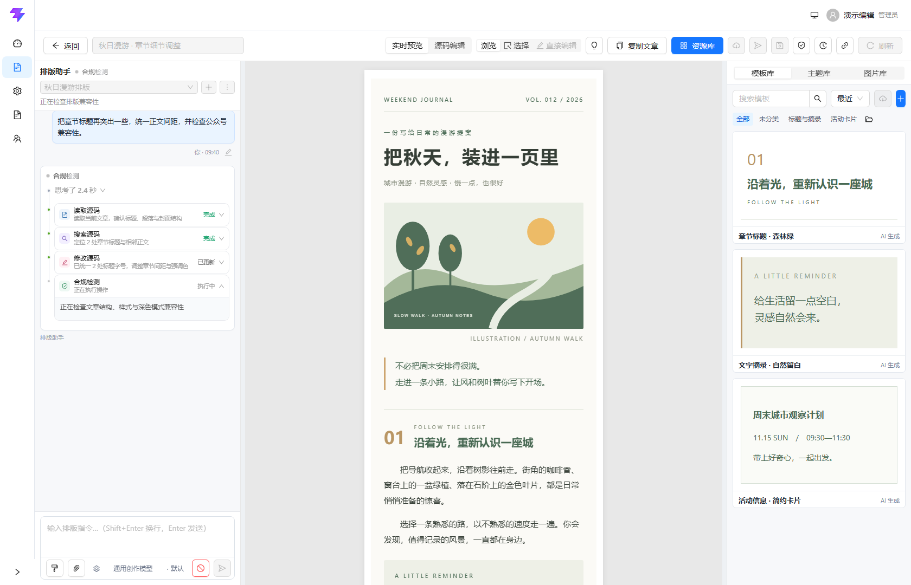

### 从文章整理到公众号草稿

<table>
  <tr>
    <td width="50%" valign="top">
      <a href="docs/images/workbench.png">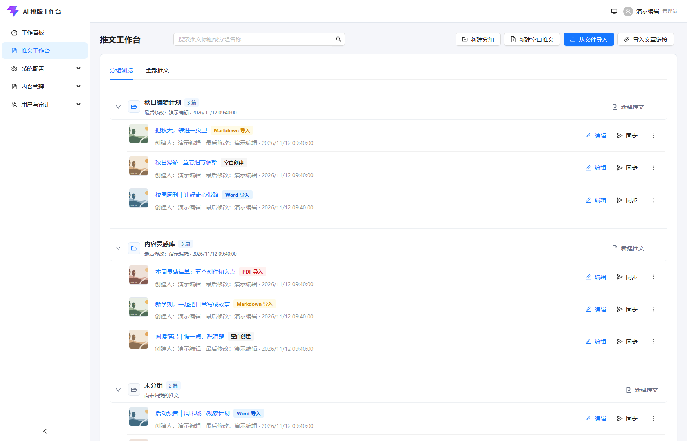</a>
      <br /><b>推文工作台</b><br />按分组整理文章，查看编辑状态，继续已有创作。
    </td>
    <td width="50%" valign="top">
      <a href="docs/images/editor.png">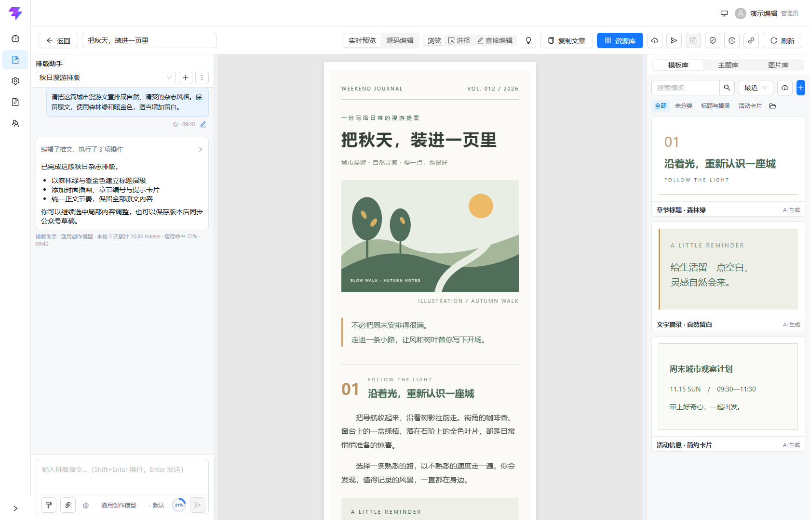</a>
      <br /><b>对话式排版编辑器</b><br />通过自然语言调整文章，同时查看预览与组件模板。
    </td>
  </tr>
  <tr>
    <td width="50%" valign="top">
      <a href="docs/images/themes.png">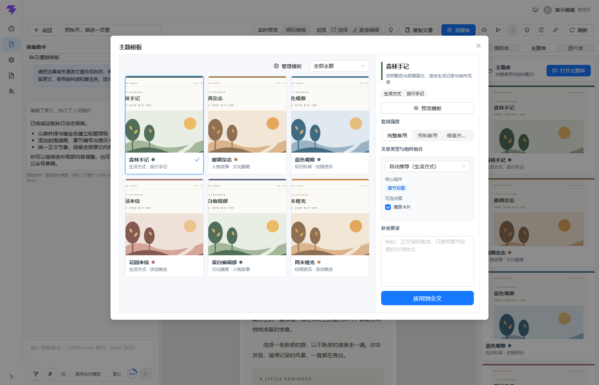</a>
      <br /><b>整篇主题与组件配方</b><br />预览主题风格，选择套用强度、核心组件与可选点缀。
    </td>
    <td width="50%" valign="top">
      <a href="docs/images/image-library.png">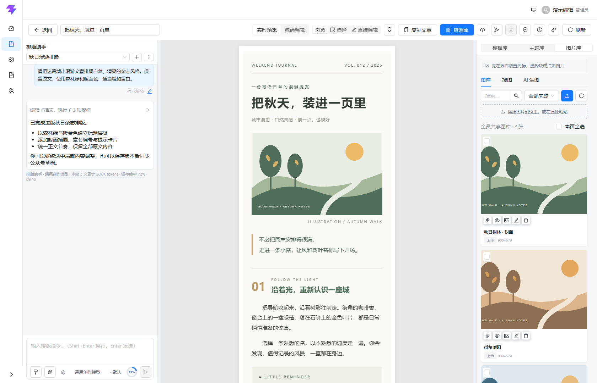</a>
      <br /><b>编辑器图片库</b><br />在文章旁浏览和搜索素材，将图片加入当前创作。
    </td>
  </tr>
  <tr>
    <td width="50%" valign="top">
      <a href="docs/images/version-history.png">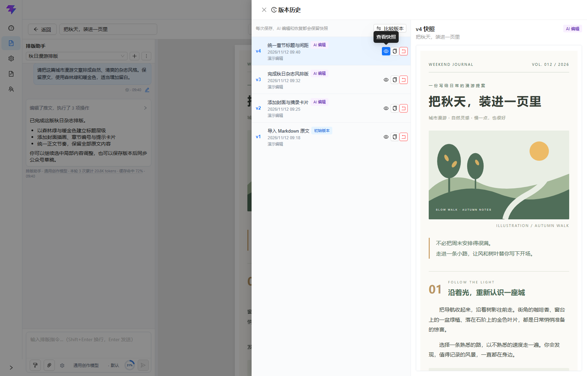</a>
      <br /><b>版本历史与快照</b><br />回看每次修改及对应文章快照，按需比较或恢复版本。
    </td>
    <td width="50%" valign="top">
      <a href="docs/images/wechat-draft.png">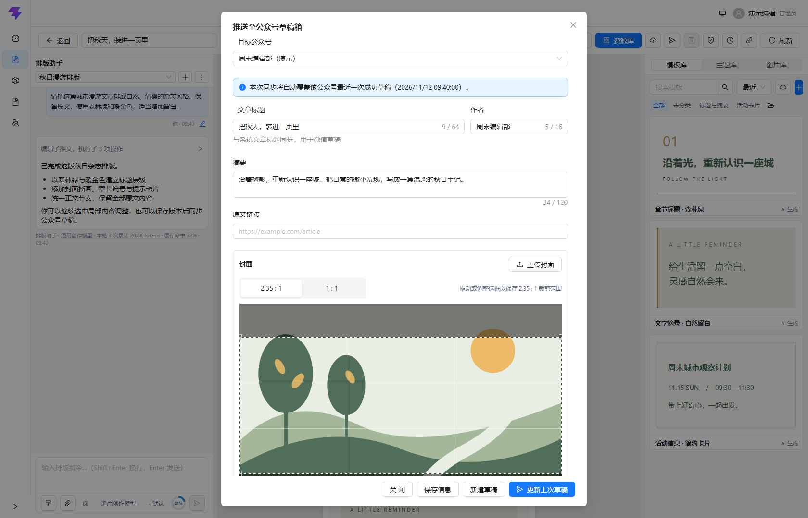</a>
      <br /><b>公众号草稿同步</b><br />选择目标账号，确认标题、摘要与封面裁剪后创建或更新草稿。
    </td>
  </tr>
</table>

### 工作看板与管理后台

<table>
  <tr>
    <td width="50%" valign="top">
      <a href="docs/images/workboard.png">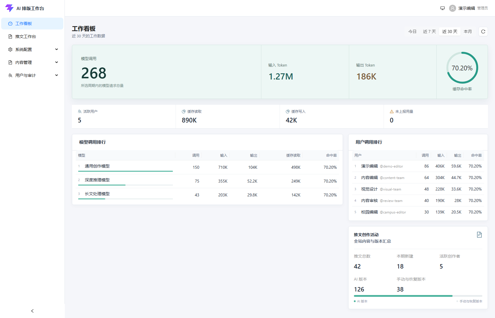</a>
      <br /><b>调用与创作看板</b><br />查看模型用量、缓存命中、用户调用排行与推文创作活动。
    </td>
    <td width="50%" valign="top">
      <a href="docs/images/models.png">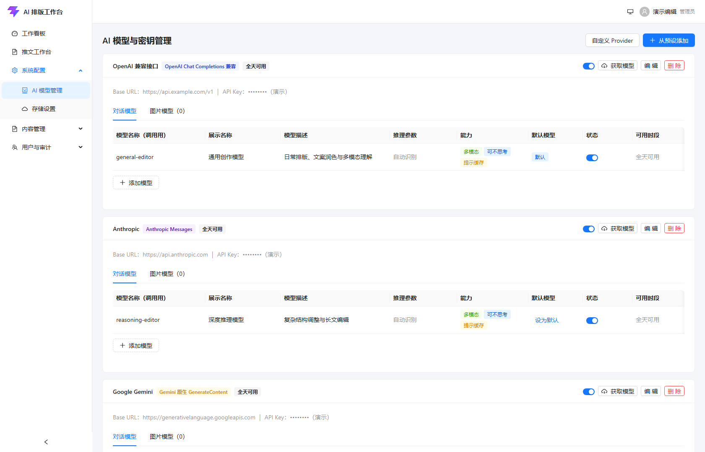</a>
      <br /><b>AI 模型管理</b><br />统一管理 Provider、默认模型、模型能力与可用时段。
    </td>
  </tr>
  <tr>
    <td width="50%" valign="top">
      <a href="docs/images/users.png">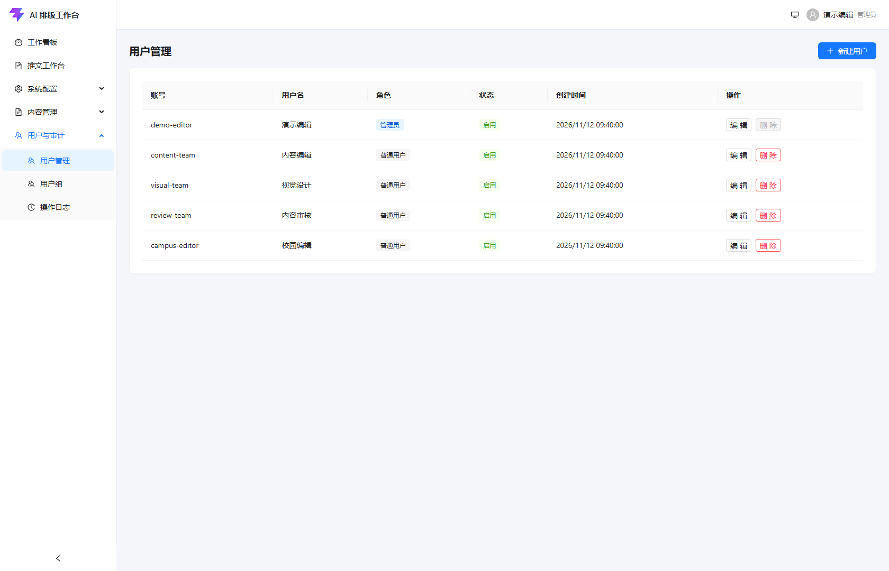</a>
      <br /><b>用户管理</b><br />维护编辑账号、管理员角色与账号启用状态。
    </td>
    <td width="50%" valign="top">
      <a href="docs/images/admin-image-library.png">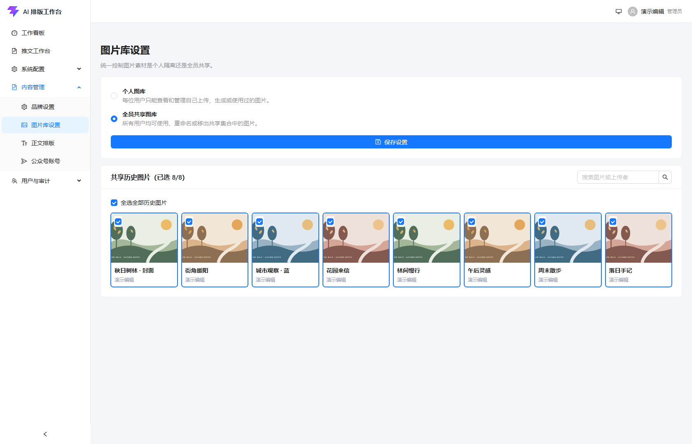</a>
      <br /><b>共享素材管理</b><br />设置个人或共享图库，统一选择可供团队复用的素材。
    </td>
  </tr>
</table>

## 技术栈

| 层级       | 技术                                                                                 |
| ---------- | ------------------------------------------------------------------------------------ |
| 前端       | React、TypeScript、Vite、Ant Design                                                  |
| 后端       | Python 3.11+、FastAPI、SQLAlchemy、MySQL                                             |
| AI 编排    | LangGraph、OpenAI 兼容接口 / Responses API、Anthropic Claude、Google Gemini 原生 API |
| 文档与存储 | PyMuPDF、python-docx、对象存储厂商 SDK                                               |

```text
浏览器（React + Vite）
        │ /api
        ▼
FastAPI（鉴权、Agent、文档、同步、SSE）
   ├── MySQL（用户、配置、文章、会话、版本）
   ├── 本地存储或对象存储（文件与图片）
   ├── 已配置的 AI Provider
   └── 可选：SearXNG、微信公众号接口
```

## 快速开始

### 环境要求

- Python 3.11 或更高版本
- Node.js 20.19+ 或 22.12+（仅前端开发/构建需要；生产运行不需要 Node.js）
- Chromium（Python Playwright 用于官方微信合规检测）
- MySQL 5.7 或 8.0，数据库字符集必须为 `utf8mb4`（正式部署必需；SQLite 仅用于本地实验和测试）
- 可选：Docker Compose（运行 SearXNG 搜图服务）

### 1. 创建数据库

使用有建库权限的 MySQL 账号创建数据库（以下以 `article_editor` 为例），并在后端 `DATABASE_URL` 中填写一致的数据库名及实际账号密码：

```sql
CREATE DATABASE article_editor
  CHARACTER SET utf8mb4
  COLLATE utf8mb4_unicode_ci;
```

### 2. 启动后端

```powershell
cd backend
python -m venv venv
.\venv\Scripts\Activate.ps1
pip install -r requirements.txt
python -m playwright install chromium
Copy-Item .env.example .env
```

在 `backend/.env` 中至少填写真实的 `DATABASE_URL`。开发环境可让 `ENCRYPTION_KEY` 留空，应用会在首次启动时生成本地密钥；生产环境必须显式配置强随机的 `SECRET_KEY` 和 `ENCRYPTION_KEY`。

```powershell
# 开发环境必须使用 8002，与前端 Vite 的默认代理一致
python -m app.dev_server --host 127.0.0.1 --port 8002
```

macOS / Linux 激活虚拟环境时使用 `source venv/bin/activate`，复制配置文件时使用 `cp .env.example .env`。
如果将后端改用其他端口，请在启动前端前设置进程环境变量 `VITE_API_PROXY_TARGET`，使 Vite 代理指向相同地址（PowerShell 使用 `$env:VITE_API_PROXY_TARGET = 'http://127.0.0.1:端口'`，macOS/Linux 使用 `VITE_API_PROXY_TARGET=http://127.0.0.1:端口 npm run dev`）。

后端启动时会自动创建缺失的数据表并执行兼容性 schema migration；已有数据库请先完成备份。
token 估算使用仓库内置并校验哈希的 `o200k_base` 字表，启动时预加载，无需在线下载；实际计费以提供方返回的用量为准。
官方合规 Chromium 在首次检测时才启动，由单个工作线程复用；默认空闲 10 秒释放浏览器、120 秒释放 Playwright 驱动。编辑、保存和同步草稿不会自动发起检测，编辑后只会使上次报告失效。

### 3. 启动前端

```powershell
cd frontend
npm ci
npm run dev
```

访问 [http://localhost:5173](http://localhost:5173)。开发环境首次初始化且用户表为空时，会创建默认管理员账号 `admin` / `admin123`；请在首次登录后立即修改密码。生产环境必须在 `.env` 中设置自定义管理员账号和密码，不能使用这组默认凭据。

### 4. 完成初始配置

1. 使用管理员账号登录，在“AI 模型管理”中按需添加可用 Provider 和模型；未配置 Provider 时仍可导入、手动编辑和预览，但 AI 对话与 AI 生图不可用。
2. 按需在“文件存储”配置对象存储；未配置时系统使用 `backend/data/uploads` 本地存储。
3. 在“排版工作台”新建文章或导入文档，选择模型后开始对话式排版。

API Key、对象存储凭据、AppSecret、`.env`、数据库和 `backend/data/` 都是私密数据，不得提交到仓库或公开发布。

## 可选服务与生产部署

- **图片搜索**：编辑器搜图功能使用独立的 SearXNG 服务。配置与国内来源验证步骤见 [SearXNG 部署说明](deploy/searxng/README.md)。未启动时仅搜图不可用，其他功能仍可使用。
- **对象存储**：可通过管理界面配置；本地存储模式在生产环境必须将 `backend/data/uploads` 挂载到持久化卷。
- **公众号草稿同步**：需要公众号具备相应接口权限，并将部署服务器公网出口 IP 加入公众号后台 API IP 白名单。
- **文章链接导入与模仿排版**：普通公开 HTTPS 文章可直接解析；微信公众号页面在服务端验证失败时，需要 Chrome/Edge 排版采集助手。构建与安装见[排版采集助手部署说明](deploy/layout-capture-extension.md)。
- **生产环境**：生产服务默认监听 `127.0.0.1:8001`，建议在 Nginx 后运行。详见[常规 Linux 部署](docs/DEPLOY_LINUX.md)或[宝塔面板部署](docs/DEPLOY_BAOTA.md)。
- **小内存部署**：2 核 2 GiB 且应用、MySQL、SearXNG 同机时，建议单 Uvicorn worker，并显式将 Agent 并发设为全局 2、单用户 1；应用默认值为 10 / 3，不适合作为该环境的起点。配置与复测方法见[小内存性能说明](docs/PERFORMANCE_2G.md)。
- **发布包**：可使用 [`scripts/package-release.ps1`](scripts/package-release.ps1) 构建包含前端静态资源、MySQL schema 和采集扩展的发布包；脚本要求工作区干净，并需要传入生产 HTTPS 来源。

完整配置项及默认值请参阅 [后端环境变量示例](backend/.env.example)。

### 已有部署升级

1. 备份数据库、`backend/.env`、加密密钥及本地上传目录，保留现有凭据与持久化数据。
2. 停止旧后端，更新源码并重新安装后端依赖；前端使用 `npm ci`，按部署来源先构建采集扩展，再执行 `npm run build`。
3. 对照 `.env.example` 补齐新增配置，以单 worker 启动后端并等待自动迁移完成。本轮包含运行性能索引、图片共享引用与直接图片输入的兼容迁移，SQL 参考文件位于 `deploy/migrations/`。
4. 验证登录、文章加载、AI 编辑、图片引用、历史任务恢复和手动合规检测；使用采集助手时同步升级浏览器扩展。

源码工具默认使用 `CHAT_AGENT_TOOL_PROTOCOL=v2`；可设为 `v1` 后重启来回退**新运行**，已暂停任务继续沿用保存的协议。提示缓存由管理员按模型开启，应先验证对应网关。

## 开发与测试

```powershell
# 后端
cd backend
python -m unittest discover -s tests

# 前端
cd frontend
npm run lint
npm run test
npm run build:layout-capture-extension
npm run build
```

源码协议的离线机制对照可在 `backend` 目录执行 `python scripts/benchmark_source_agent.py`；上下文性能可运行 `python scripts/benchmark_context_preflight.py --output ../tmp/context-performance.json`。需要 `--live` 的基准会调用已配置的真实模型，可能产生费用，参数与适用范围见对应专题文档。

提交或发布前，请使用 `git status --short` 确认未暂存 `.env`、数据库、上传文件，以及 `outputs/`、`tmp/`、`debug-artifacts/` 等本地或调试产物。上述目录已被 Git 忽略，运行报告中的请求、图片、页面快照及部署配置应留在本地。

## 项目结构

```text
backend/
  app/api/          HTTP 与 SSE 接口
  app/services/     Agent、源码工作区、上下文、图片、微信集成
  app/models/       数据模型
  app/assets/       离线 tokenizer 字表及许可
  scripts/          性能测量与模型诊断脚本
  tests/            后端回归测试与 fixtures
frontend/
  src/              React 页面、组件、API 与工具
  extension/        Chrome / Edge 采集助手源码
deploy/             MySQL schema、增量 SQL、Nginx 与可选服务配置
docs/               部署、架构、性能及验收说明
scripts/            发布包构建脚本
_third_party/       保留许可与来源记录的第三方快照
```

## 文档导航

| 主题                           | 文档                                                                                                    |
| ------------------------------ | ------------------------------------------------------------------------------------------------------- |
| 前端开发、代理与扩展构建       | [前端说明](frontend/README.md)                                                                           |
| Linux / 宝塔生产部署           | [Linux 部署](docs/DEPLOY_LINUX.md) · [宝塔部署](docs/DEPLOY_BAOTA.md)                                    |
| Chrome / Edge 排版采集助手     | [构建、安装与企业分发](deploy/layout-capture-extension.md)                                               |
| 源码工具、授权边界与旧协议回退 | [源码 Agent](docs/SOURCE_AGENT.md)                                                                     |
| 上下文预算、压缩、图片与恢复   | [上下文管理](docs/CONTEXT_MANAGEMENT.md)                                                                |
| 模型提示缓存与用量统计         | [提示缓存优化](docs/PROMPT_CACHE_OPTIMIZATION.md)                                                        |
| 小内存资源配置与性能复测       | [2 核 2 GiB 部署](docs/PERFORMANCE_2G.md)                                                                |
| 微信规范与生成提示约束         | [规则维护说明](docs/WECHAT_PROMPT_RULES.md)                                                              |
| 搜图与第三方许可               | [SearXNG](deploy/searxng/README.md) · [第三方声明](THIRD_PARTY_NOTICES.md)                                |

## 关于作者与维护

作者并非计算机相关专业科班出身，本项目绝大部分代码由 AI 生成。由于需要兼顾学业，投入项目维护的时间和精力有限，项目更新、问题修复及 Issue / Pull Request 的处理可能不够及时，维护也可能有所疏漏，敬请理解。

## 贡献

欢迎通过 Issue 反馈问题，并以 Pull Request 提交改进。提交前请运行与修改相关的检查，并保留现有版权及许可证声明。请不要在 Issue、日志、截图或提交记录中泄露访问令牌、用户数据、公众号凭据或其他敏感信息。

## 第三方组件、合规与免责声明

- 本项目集成了 `gzh-design-skill` 的源码快照，用于主题组件和 HTML 校验；其版权声明与 AGPL 许可证保留在原目录。其他第三方来源与分发注意事项见 [第三方声明](THIRD_PARTY_NOTICES.md)。
- 第三方声明还记录了 AI 输出界面采用的 AICSS 示例代码；其公开许可证或条款在本声明编写时尚未确认，正式分发前请完成许可审查、取得授权或替换相关实现。
- 本项目与微信、腾讯、OpenAI、Anthropic 及其他模型、存储或搜索服务商均无官方隶属或授权关系。
- 部署者与内容发布者须自行遵守适用法律、微信公众号平台规则、第三方服务条款及图片、文字、商标等内容的授权要求。

## 许可证

本项目以 [GNU Affero General Public License v3.0 or later](LICENSE)（`AGPL-3.0-or-later`）发布。由于项目包含并集成 AGPL 第三方组件，通过网络向用户提供本项目服务时，请履行 AGPL 对对应源码提供的义务。

## 赞赏

如果本项目对你有所帮助，欢迎赞赏支持项目持续维护与改进。

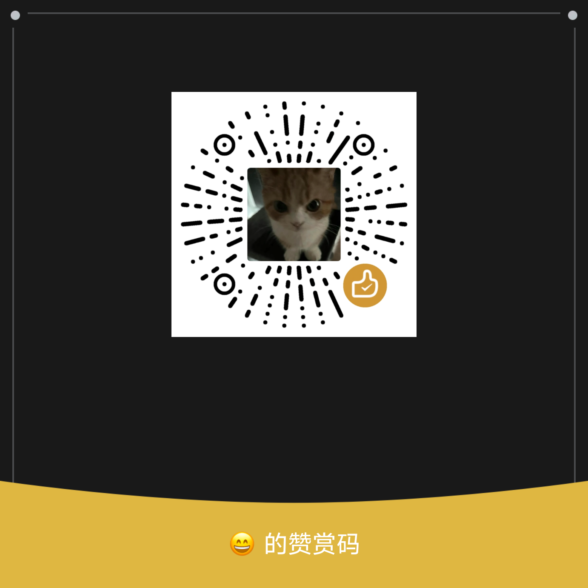
