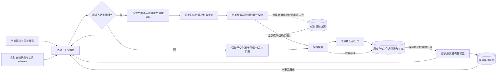
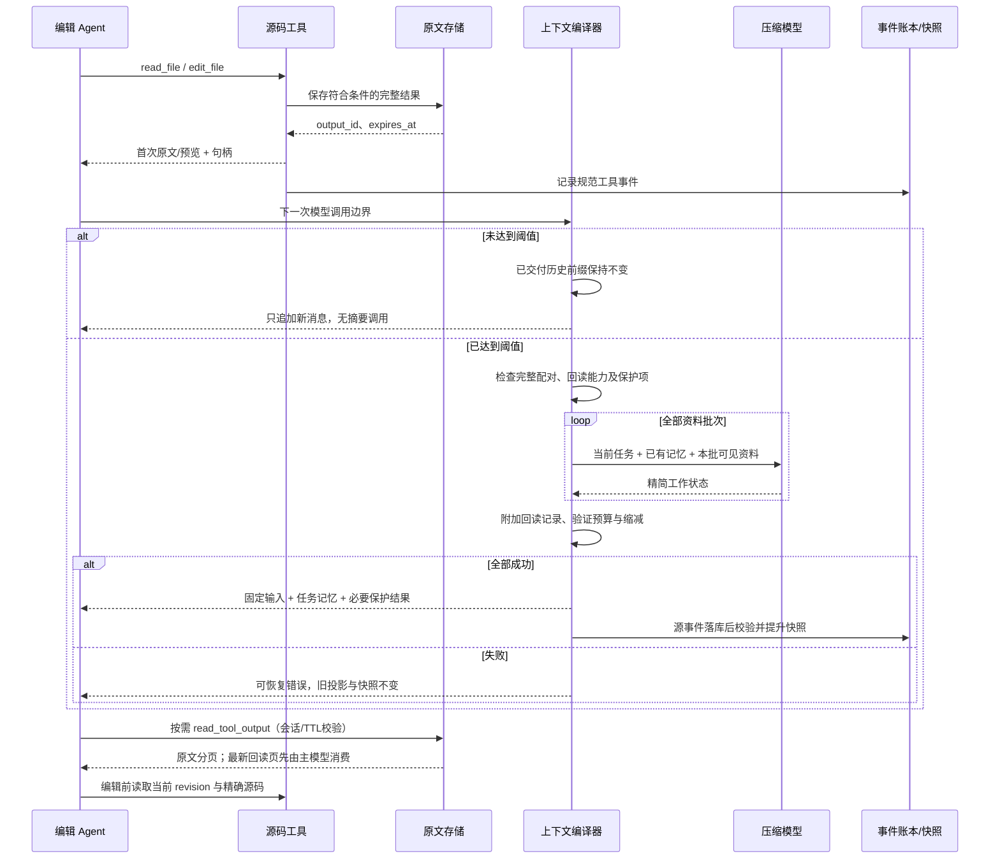

# Agent 上下文管理：源码研究与项目实现

更新：2026-11-03。交互说明：[context-management.html](context-management.html)。

管理范围从“达到阈值后生成摘要”扩展到工具输出的整个生命周期：有界读取 → 保存可回读原文 → 首次交付后保持历史前缀稳定 → 达到阈值时集中重建精简任务状态。**不设置固定压缩后 token 数、不设置目标压缩比例，也不为了少几个输入 token 逐轮改写可缓存的历史。**

## 问题的实际构成

早期实现保留最近三组工具结果，并重复携带已经进入摘要的历史前缀，同一离线样例只能从 41,266 降到 26,900 tokens。上一版修正后降到 12,343，但其中约 12,163 是固定开销、当前请求及最后一组工具结果，摘要与包装只占约 180。继续缩摘要无法解决主要瓶颈。

现在，完整、成功、已归档的源码工具循环可以交给压缩模型消费并生成交接状态；服务端附加精确回读记录。错误、控制工具、图片、未配对完成的循环，以及最新 `read_tool_output` 回读结果仍保留必要原文。

## 实际阅读的上游源码

以下为本次读取的固定快照。各项目的默认路径、功能开关和服务端原生压缩并不相同；迁移的是设计原则，没有复制上游实现。

| 项目与版本 | 源码观察 | 本项目结合方式 |
| --- | --- | --- |
| **Codex** `bfdbf01bfaeaa6ab23b10e2bd64ed031fd1e5619` | [history.rs:L544](https://github.com/openai/codex/blob/bfdbf01bfaeaa6ab23b10e2bd64ed031fd1e5619/codex-rs/core/src/context_manager/history.rs#L544)：工具输出截断只作用于活动历史，保留 rollout 原文；[compact.rs:L397](https://github.com/openai/codex/blob/bfdbf01bfaeaa6ab23b10e2bd64ed031fd1e5619/codex-rs/core/src/compact.rs#L397)：重建替代窗口并重新计量；[交接提示词](https://github.com/openai/codex/blob/bfdbf01bfaeaa6ab23b10e2bd64ed031fd1e5619/codex-rs/prompts/templates/compact/prompt.md)：进展、决策、约束、下一步、引用 | 活动投影与规范事件分离；成功后替换历史、重新计量；原始输出存入已有工具存储 |
| **OpenCode** `6d1c444b8c53da667b51ed45b0a7c0aca1174674` | [compaction.ts:L170](https://github.com/anomalyco/opencode/blob/6d1c444b8c53da667b51ed45b0a7c0aca1174674/packages/core/src/session/compaction.ts#L170)：结构化检查点，优先引用，省略可从文件恢复的内容，删除失效事项；该版本默认 `keep:15000`、`precompute:false`；[tool-output.ts](https://github.com/anomalyco/opencode/blob/6d1c444b8c53da667b51ed45b0a7c0aca1174674/packages/core/src/tool-output.ts)：输出限流、原文文件与清理 | 摘要承载决策与任务状态，文件正文改用路径/结果 ID 引用；复用会话权限和 TTL 存储，没有照搬 15K 保留窗口 |
| **Gemini CLI** `0ac57c029b848d109eef940afe0db4b5a0c3dad0` | [toolOutputMaskingService.ts:L26](https://github.com/google-gemini/gemini-cli/blob/0ac57c029b848d109eef940afe0db4b5a0c3dad0/packages/core/src/context/toolOutputMaskingService.ts#L26)：旧输出外置、控制工具豁免、保护近期数据、有收益才替换；该服务默认保护 50K 工具 tokens、积累 30K 可清理量；[chatCompressionService.ts](https://github.com/google-gemini/gemini-cli/blob/0ac57c029b848d109eef940afe0db4b5a0c3dad0/packages/core/src/context/chatCompressionService.ts)：预算处理、摘要与校验，存在保留最近 30% 的路径及二次摘要核查 | 采用保护控制/失败/图片/回读、完整配对与回读能力；正文仅在压缩边界集中退出，未移植固定门槛或逐轮清理 |
| **Cline SDK** `5b454165353ac1edc9a7db0ff416739044985908` | [agentic-compaction.ts](https://github.com/cline/cline/blob/5b454165353ac1edc9a7db0ff416739044985908/sdk/packages/core/src/extensions/context/agentic-compaction.ts)：旧摘要与新增消息合并、摘要独立输入预算、收集文件操作；[basic-compaction.ts](https://github.com/cline/cline/blob/5b454165353ac1edc9a7db0ff416739044985908/sdk/packages/core/src/extensions/context/basic-compaction.ts)：确定性应急收缩；[compaction.ts:L330](https://github.com/cline/cline/blob/5b454165353ac1edc9a7db0ff416739044985908/sdk/packages/core/src/extensions/context/compaction.ts#L330)：未知窗口不乱触发、usage 检查低估、拒绝无收益候选 | 完整批次覆盖、旧记忆合并、增加“新输入必须更小”的验收；保留现有保守估算，没有在缺少配对 usage 时降低系数 |

补充依据：[OpenAI Compaction](https://developers.openai.com/api/docs/guides/compaction)、[Anthropic context engineering](https://www.anthropic.com/engineering/effective-context-engineering-for-ai-agents)。Claude Code 私有核心无法从这些资料核验，这里引用其公开工程文章，不声称读过私有源码。

这些源码不支持“顶尖 Agent 一定压到统一极低比例”的说法。不同实现保留不同工作集，还有 native compaction、结构应急和异步预计算等分支。可迁移的核心是限制活动输入、外置可恢复内容、准确维护任务状态。

## 源码里的缓存策略，以及本次纠正

此前版本把“结果已消费且可回读”直接作为逐轮清理条件。这漏掉了前缀缓存的成本，现在已移除这条路径。输出是否可以恢复，决定它能否进入交接；输入是否达到阈值，决定何时重建历史。两者不能混为一个触发条件。

- **OpenCode 明确延迟应用摘要。** [compaction.ts:L331](https://github.com/anomalyco/opencode/blob/6d1c444b8c53da667b51ed45b0a7c0aca1174674/packages/core/src/session/compaction.ts#L331) 写明后台结果先保留，到真正需要压缩才替换，否则会提前改写前缀并丢失缓存。该版本预计算默认关闭；这是可选路径的设计，不是所有会话都在后台摘要。
- **摘要请求也尽量使用原前缀。** [同文件 L433](https://github.com/anomalyco/opencode/blob/6d1c444b8c53da667b51ed45b0a7c0aca1174674/packages/core/src/session/compaction.ts#L433) 保留正常请求格式，在末尾追加摘要要求；模型、请求与供应商条件允许时复用缓存。只有无法放下等情况才降级重排。当前项目仍用独立压缩模型及 JSON 分批资料，尚不具备这项主请求缓存复用能力。
- **Gemini 是批量门槛，不是读完即清理。** 上述 masking 服务先保护近期输出，待可移出正文累计达到门槛再处理；不会因为某条旧结果有一点节省就改写它。项目未照搬这些常量，采用现有压缩边界集中整理。
- **Codex 在结果进入活动历史时限流，压缩时切换窗口。** 输出原文与活动历史分开；这与事后每轮缩写已交付历史不同。**Cline SDK** 的 [自动路径 L369](https://github.com/cline/cline/blob/5b454165353ac1edc9a7db0ff416739044985908/sdk/packages/core/src/extensions/context/compaction.ts#L369) 在未达到触发条件时直接返回，不执行压缩。

本项目现采用：**首次交付前控制输出大小 → 窗口内只追加正常消息 → 阈值处一次重建 → 新窗口继续追加**。固定规则与工具定义保持稳定；实时状态放末尾。显式工具组加载、压缩以及已有图片像素释放等路径仍会改变请求，不能承诺所有请求绝对不变。

回归比较实际 Chat Completions / Responses 序列化请求，确认归档结果在未触发期间不会改写已交付历史前缀，也验证压缩后继续追加时不重写旧消息。这是缓存复用条件验证，不是供应商命中率或费用实测。缓存指标还应包括累计未缓存输入、读取/写入成本、摘要成本、首 token 延迟。

## 技术架构

活动上下文是真正送给模型的工作集；摘要是可继续任务的语义状态；事件和外置输出用于追溯与恢复。外置输出沿用容量与 TTL，不是永久无限存储。规范事件保存实际交付结果；超大结果的完整原文由外置存储承担。

## 已落地的处理链

### 工具边界先提供回读能力

`context_projection.bind_context_tool_result` 接入真实 ToolNode 返回路径。源码读取在回读记录比原文更短时保存；成功源码写入结果也保存，以便交接时确认完成状态、移除巨大的历史写入参数。

首次交付不主动缩小预算内的内容；有余量时增加真实 output_id 和过期时间。若附加句柄会挤坏连续源码页，则保留原页及游标，内部凭据在正文移出或生成摘要时展示引用；原始事件仍保存该完整页。源结果本身超预算时继续使用有界预览。只有保存成功才附加内部回读凭据。存储失败时，预算内原文保持可见，不授予移出工作集的凭据。

复用一次调用的存储对象前校验文档、会话、工具名、校验和与过期时间，防止重试将新内容绑定到旧对象。回读页复用原对象，不创建递归归档。

### 正常推理保持历史前缀

未达到阈值时，上下文管理器原样返回已交付消息；不会因为正文已消费、能够回读或者单条变短而改写它。原文归档在首次交付前完成，输出 ID 和已返回内容保持稳定，后续正常工具结果追加到尾部。

小读取结果通常无需归档。原始 ToolMessage、调用 ID、配对顺序及规范事件不改。阈值到来后统一重建工作记忆，接受这次历史窗口切换带来的缓存重建，随后再次保持追加式运行。没有为追求缓存命中率而取消必要的深度压缩。

### 达到阈值后深度重建

历史任务与较早循环合并为工作记忆，不按“最近 N 轮”占满窗口。最新循环能否进入交接依据实际状态决定：每个调用都有唯一对应结果、成功、可回读且未过期、属于支持的源码操作，循环不含图片或其他未处理内容。

符合条件时，压缩模型读取这一轮**实际可见资料**，生成任务结论与下一步，再整组移出活动输入。服务端把最新循环的精确回读记录附加到摘要，不依赖模型生成引用。`delivery=preview` 表示只见预览，不能声称已检查隐藏原文。主模型需精确源码时重读当前文件，历史版本与坐标不能直接用于当前写入。

最新错误/警告、控制工具、用户待答、图片、不完整配对和最新 read_tool_output 页不使用这条路径。特别保护回读页，避免“摘要 → 回读 → 再摘要”的原文饥饿循环。

### 摘要约束与安全提交

摘要保留目标、约束、决策、完成情况、当前工作、阻塞、下一步、引用。提示词删除失效/被取代的旧事实，省略可从文件恢复的正文与会单独提供的系统说明。

额度由任务语义量、必要输入、回读记录及模型能力决定；12K 只是摘要输出的现有安全上限，不是总上下文目标。`compaction_target_tokens` 是必要输入和本次摘要允许额度的派生上界，不要求填满。

过长的可见源资料按文本无损分批送入，并合并已有记忆；未提供的外置原文不能冒充已经总结。所有批次成功、JSON 合法、最终输入可容纳且确实缩小后才替换活动投影。原记录不删；快照继续等待源事件落库并校验完整覆盖边界。

## 时序图

## 同一离线样例与边界案例

运行：`backend/venv/Scripts/python.exe backend/scripts/demo_context_compaction.py`。

| 阶段 | 完整输入估算 tokens | 说明 |
| --- | ---: | --- |
| 相同原始样例 | 41,266 | 五组模拟 read_file，含 4,000 schema/实时状态预留 |
| 上一版压缩后 | 12,343 | 最后一组结果无条件保留 |
| 本版实际压缩前 | 41,641 | 同一内容，增加 375 tokens 的真实归档句柄 |
| 本版压缩后 | **5,337** | 固定输入 4,890 + 摘要/包装/回读记录 447 |
| 继续两轮并保持历史不变 | **20,037** | 新增摘要调用 0 次；已有消息未改写 |

按实际输入口径节省 **87.2%**，不是目标或真实模型质量承诺。原始工具数据与任务相同，新增句柄成本单独列出，不能把 41,266 和 41,641 混为同一口径。阈值沿用原样例预算，压缩后剩余空间为 35,929 tokens。

该样例在阈值处一次提交五组已有历史，单独测量深度交接。与已撤回的逐轮清理策略相比，两轮后的 token 占用更高，但不再人为破坏已交付历史前缀。脚本使用确定性摘要器、固定时间/ID、真实归档绑定及内存 SQLite，不访问网络或生产数据库。它验证分页逐字恢复、继续执行预算与消息不变性，不能衡量真实模型遗漏约束、实际缓存费用或延迟。

回归测试覆盖源码读取、成功写入的大参数、未触发时消息不变、并行配对、错误/警告/控制/图片保护、最新回读保护、过期/跨会话拒绝、存储失败/内容冲突、压缩失败不改输入，以及真实图执行的原文交付与序列化前缀稳定性。另验证压缩后回读原文并对当前源码执行精确替换。

最终验证：后端完整测试运行 1,065 项，1,064 通过、1 项跳过；新增工作集回归 14 项均通过。HTML 在 1440px 与 390px 下验证六个标签、三阶段数据、架构节点、逐步时序、失败分支、回读展开、三种缓存策略与键盘切换，无 JS 错误或页面横向溢出；已检查渲染截图。

## 采用范围与评估边界

已采用首次输出外置、窗口内追加、阈值处最小任务交接、引用恢复、旧记忆更新、完整循环边界和候选验收；复用已有按需工具组、源码分页、即时文档状态、事件快照和缓存前缀。

没有直接迁移供应商加密 compaction item，因为项目需要多供应商兼容。没有直接加入后台预计算：Codex 的 [async_compaction.rs](https://github.com/openai/codex/blob/bfdbf01bfaeaa6ab23b10e2bd64ed031fd1e5619/codex-rs/core/src/session/async_compaction.rs) 要求特定能力与功能开关，还校验历史版本、模型、身份及取消状态；OpenCode 预计算默认关闭。项目应先具备并发快照采纳和过期丢弃协议，再引入这条路径。Gemini 的二次语义核查也未无条件加入，避免每批摘要额外增加一次模型请求。

真实模型回放还应同时观察约束保留、写入正确率、重复回读/写入、摘要次数、provider usage、首 token 延迟和总成本。本次离线验证没有冒充完成这项评估。

## 代码入口

- `backend/app/services/context_projection.py`：存储绑定、受信回读记录、最新循环交接条件。
- `backend/app/services/tool_output_store.py`：归档、预算内原文首发、冲突校验、分页与 TTL。
- `backend/app/services/chat_agent.py`：真实图路径接入、分批交接、预算与活动投影。
- `backend/app/services/agent_context.py`：会话工作记忆、完整可见资料送达与快照校验。
- `backend/app/api/routes/chat.py`：源事件持久化后提升运行摘要为快照。
- `backend/tests/test_context_projection.py`、`test_run_compaction.py`、`test_context_event_ledger.py`、`test_source_prompt_cache.py`：恢复、配对、预算、快照和缓存验证。
