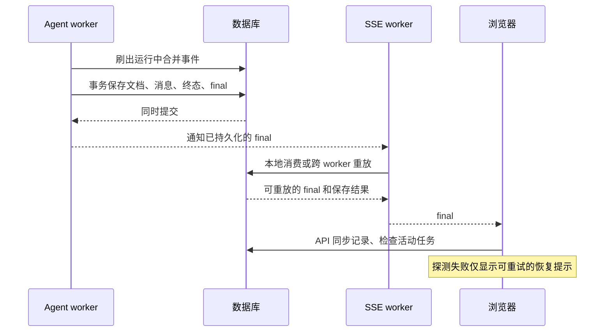

# Agent 完成通知与恢复提示

## 本次日志能确认什么

2026-11-04 的运行 `82fc0600-be36-4e81-ade1-c8ee240f4688` 在 12:43:37 完成模型输出，12:43:38 提交 `status=completed` 和助手消息 `2113`。`html_changed=False`，该轮完成了比对，没有正文修改需要保存。之后出现的 `agent_run_event_batch_rejected count=1` 属于事件发布阶段。

截图中的“恢复 Agent 输出失败”来自前端空闲状态探测的异常分支。日志没有包含该探测的 HTTP 错误详情，因此不能据此断言线上网络故障的具体原因。代码与离线故障注入确认了两个需要修复的缺陷：后台提交终态与写入最终事件之间存在窗口；前端把恢复探测失败误报为本轮执行失败。

## 后端行为

- 在任务仍处于运行状态时刷出合并的文字增量和上下文事件。
- 文档、助手消息、运行终态和可重放的 `final` 事件在同一个数据库事务提交。事件序号在运行行锁保护下，取运行游标与事件表最大序号的较大值再递增。
- 提交后先通知本 worker 的订阅者，再发布附加遥测，避免后续事件先推进订阅游标。其他 worker 从数据库读取时也能同时看到终态和 `final`。
- 若停止看门狗已经保存终态，则重用已保存的最终事件与消息，避免重复保存或用迟到输出覆盖结果。
- 遥测或前缀刷出失败不能阻止保存已完成的编辑。数据库不可用时保留原有降级路径，不把未确认落库的候选正文当作已保存结果展示。

## 前端场景

| 场景 | 界面与恢复行为 |
| --- | --- |
| 本轮完成，随后活动任务查询断网 | 查询按现有有界退避最多请求 3 次，保留回复；显示“暂时无法检查后台任务状态”和“重新检查并同步” |
| 收到 final 后同步记录失败 | 保留已显示结果，不恢复已完成请求到输入框；提供记录同步入口 |
| SSE 未收到 final，但状态 API 返回终态 | 接受持久终态，不再次连接输出或重新创建任务；记录读取失败另行提示 |
| 状态 API 确认真正失败，同步记录也失败 | 保留真实执行错误；新请求的草稿仍可恢复，记录同步提示不会覆盖失败原因 |
| 正在等待用户确认，同步记录失败 | 保留确认面板，提示确认面板已恢复，不声称本轮已经结束 |
| 离开编辑页或切换文档 | 取消状态查询及退避；迟到的结果不能更新另一个文档 |
| 手动重试此前恢复过的同一个运行 | 没有连接或新建请求在进行时，允许重新连接；保留防止重复连接的保护 |
| 手动同步时存在未保存源码 | 不用服务器正文覆盖当前未保存的源码 |

状态读取重试只重读 GET 接口，不重新发送任务 POST。恢复提示与真实执行失败分开显示。

## 验证与生效

后端测试覆盖提交后、本地通知前跨 worker 重放，合并事件在终态前落库、单一 final、本地最终通知先于后续遥测，以及已有停止/冲突/恢复路径。前端测试覆盖网络重试、取消、跨文档隔离、完成后同步失败、真实失败与待确认状态、同一运行手动重连。

实际 SMS 生产构建在桌面和手机 Chromium 中注入“完成后状态查询连续断网 3 次”，确认已保存回复仍可见、没有“对话请求未完成”误报，手动同步成功，任务 POST 始终只有 1 次，浏览器没有页面异常。验证脚本与截图保存在本机 `tmp/verify_terminal_recovery_ui.py`、`tmp/terminal-recovery-browser.json` 和 `tmp/terminal-recovery-*.png`。

主版和 SMS 均需更新后端代码并重新加载 worker，前端使用各自最新 `frontend/dist`。本次没有执行远程部署或重启线上服务；无需修改表结构。
